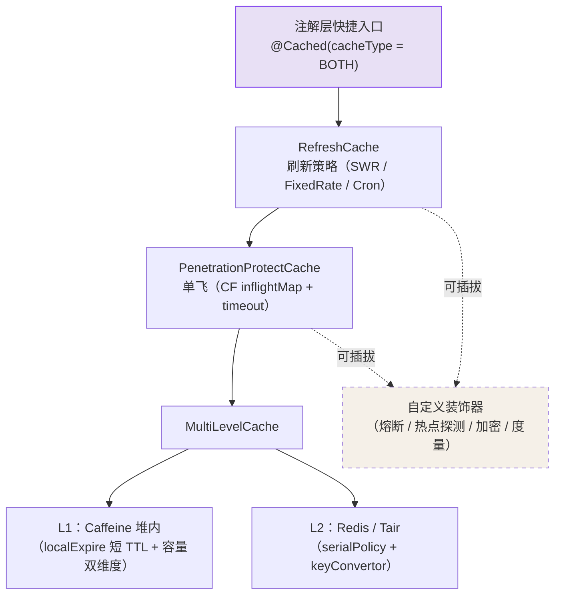

***

title: 分布式缓存框架底层设计方法论 — 以 JetCache 注解体系为锚点的逆向拆解
tags: \[redis, jetcache, cache, architecture, cache-design, singleflight, swr]
date: 2026-09-02
source: ai-conversation
-----------------------

> 本文档的目标：**如果来自研分布式缓存框架，每个设计点为什么这样定，有什么坑，业界有什么别的走法**。
> 以 JetCache 的注解与参数为拆解锚点（因为它是 Java 生态中设计最完整的注解式缓存框架），但不是 JetCache 使用手册。
>
> 每个参数强制覆盖四点：**为什么需要 → 为什么这样设计（trade-off）→ 好处/坏处 → 业界其他实现路径**。
>
> 相关阅读：[分布式缓存设计取舍-JetCache落地全景](分布式缓存设计取舍-JetCache落地全景.md)（8 维取舍矩阵 + 电子元器件商城场景落地决策）、[JetCache源码解析](JetCache源码解析.md)、[JetCache使用教程](JetCache使用教程.md)

## 目录

- 零、框架设计的六个元问题

- 一、`@Cached` 注解 — 13 个设计参数逐项拆解（area / name / key / expire / cacheType / localLimit / localExpire / serialPolicy / keyConvertor / cacheNullValue / condition / postCondition / enabled）

- 二、`@CacheRefresh` — 定时器刷新注解（refresh / stopRefreshAfterLastAccess / refreshLockTimeout）

- 三、`@CachePenetrationProtect` — 单飞防击穿

- 四、`@CacheUpdate` / `@CacheInvalidate` — 缓存更新与失效

- 五、全局配置的设计要素（areaInCacheName / statIntervalMinutes / broadcastChannel）

- 六、底层架构设计模式对比（拓扑扩展模型 / 单飞实现模型 / 刷新范式）

- 七、生存性主题 — JetCache 缺席、但生产级框架必须回答的 8 个问题（热 key / 大 value / 熔断降级 / 请求合并 / 预热 / 资源隔离 / Redis 新能力 / 混沌与容量治理）

- 八、正确性层 vs 生存性层：自研范围最终裁决

- 九、自研缓存框架的设计检查清单

***

## 零、框架设计的六个元问题

任何自研缓存框架之前，先回答这 6 个元问题，否则所有参数设计都是拍脑袋：

1. **缓存的本质矛盾是什么？** —— 一致性（拿到新值）和效率（不回源/不阻塞）的不可调和。所有设计都是在这条线上找落点。
2. **你做的是「库」还是「平台」？** —— 库是零依赖嵌入别人的代码，平台要接外部依赖（ZK、etcd）。JetCache 选了「库」的定位（只靠 Spring + 已有的 Redis/Caffeine），所以分布式锁必须复用 Redis，而不能引入 etcd 做全局协调。
3. **默认值哲学是什么？** —— 「默认最安全（所有保护全开）」vs 「默认最简单（所有开关全关，无副作用）」。JetCache 选了后者：单飞默认关、cacheNullValue 默认关、penetrationProtect 全局关——本质是选择「最小惊讶原则」而不是「最强保护原则」。
4. **复杂度放在框架里还是交给调用者？** —— 比如 SWR：框架如果内置，要判断业务接受度、阈值、失败策略，复杂度极高；JetCache 选择不做，交给用户自己按场景组合。**复杂度不会消失，只会转移。**
5. **失败时的语义是什么？** —— 缓存操作失败（Redis 超时/网络抖动）时，是 fail-closed（抛异常，不访问 DB）还是 fail-open（穿透到 DB，牺牲性能保可用性）？JetCache 选择 fail-open，这决定了为什么 `@CacheInvalidate` 失败只能靠 TTL 兜底，不能抛异常回滚。
6. **正确性和生存，优先保哪个？** —— 前五个问题回答的是「缓存行为对不对」（TTL 语义、一致性、单飞正确性），但缓存挂掉、DB 挂掉、流量倾斜 10 倍时系统还活不活得下来，是另一组完全不同的问题。JetCache 的能力基本全部集中在「正确性层」，「生存性层」（热 key、熔断降级、预热、隔离）几乎空白——这是评估自研范围时最重要的分界线（详见第 7、8 章）。

***

## 一、`@Cached` 注解 — 方法级缓存的 13 个设计参数逐项拆解

`@Cached` 是 JetCache 的核心注解，对应 Spring Cache 的 `@Cacheable`，但多了 TTL、二级缓存、条件缓存等原生能力。

### 1.1 `area` — 缓存区域命名空间

- **默认值**：`"default"`

#### 为什么需要这个参数？

多租户 / 多后端场景下，一套应用可能连**多组缓存集群**：比如热数据走本地机房高性能 Redis，冷数据走跨机房 Tair；或者按业务域分（商品域一个 Redis 集群，订单域另一个）。`area` 就是为了**让同一套注解代码在不同集群间切换，不改代码只改 area 值**。

#### 为什么这样设计（area + name 两级命名空间）：

和 Spring Cache 的 `cacheManager` 多实例方案对比：Spring 用不同的 `CacheManager` Bean 来区分后端，是「对象级隔离」；JetCache 用 `area` 字符串指向配置里的 key，是「路由级隔离」。

- 选字符串路由的好处：注解上改动极小（`area="hot"` / `area="cold"`），不需要在注解上引用不同的 Spring Bean

- 代价：area 字符串如果写错（拼错 area 名），会 fallback 到 default area，行为静默错误，不会抛出异常 —— 这是「字符串路由」的通病

#### 好处 / 坏处

| ✅ 好处                                                            | ❌ 坏处                           |
| --------------------------------------------------------------- | ------------------------------ |
| 多后端 / 多租户场景优雅，注解代码零感知                                           | 90% 团队只有一个 area，这个参数是纯噪音，容易被误用 |
| 和 yml / config 中的 `local.default` / `remote.hot` 这种多 key 配置天然对应 | 字符串匹配，没有编译期检查，拼错 = 静默走错配置      |

#### 业界其他实现路径

- **Spring Cache** **`cacheManager`** **引用**：用 Bean 引用而非字符串，编译期可查，但注解写起来重（`cacheManager="hotCacheManager"`）

- **多 Cache 接口泛型参数化**：`Cache<HotArea> cache`，用 Java 泛型约束 area，极度类型安全，但需要 APT（编译期注解处理器）生成代码，工程代价大

- **自研结论**：如果只有一个集群，**去掉 area 这个抽象**，直接用全局后端；如果确实有多后端，推荐 Spring 方式的 Bean 引用而不是字符串路由，编译期排错优先级高于简洁性。

***

### 1.2 `name` — 缓存实例名 / key 前缀

- **默认值**：未定义，自动生成（规则：`类名.方法名`）

#### 为什么需要这个参数？

两个硬需求：

1. **远程缓存 key 前缀**：多个方法共用一个 Redis，需要用 name 把 key 空间分开（`userCache:123` vs `skuCache:123`），防止 key 碰撞
2. **统计标识**：JetCache 按 name 输出 QPS / HitRate / LoadCount 统计，name 是聚合维度

#### 为什么这样设计（name 非必填，缺省自动生成）：

这是典型的「**入门门槛优先**」设计——新手上来什么都不配也能跑，框架默默帮你生成合理的默认值。
但这是一个**隐蔽且昂贵的 trade-off**：

- 自动生成的 name（`SkuServiceImpl.getSkuDetail`）太长，每个 Redis key 多占 30+ 字节，百万级 key 就是几十 MB 的纯浪费

- 重构类名 / 方法名后 key 前缀自动变，旧数据全部无效，冷启动雪崩隐患

**设计哲学冲突点**：是「零配置上手快 + 隐藏的性能坑」，还是「强制填写 + 编译期告警」？JetCache 选了前者，几乎所有开源框架都选前者（Spring Boot 的所有默认值逻辑同理）。

#### 好处 / 坏处

| ✅ 好处                 | ❌ 坏处                                                                |
| -------------------- | ------------------------------------------------------------------- |
| 上手零心智负担              | 自动生成的 key 前缀冗余，内存浪费按 key 数线性放大                                      |
| 写 demo / 小项目时几乎不需要关心 | 重构方法名→ 静默产生新的缓存空间，旧缓存全丢                                             |
| <br />               | `@CacheUpdate` / `@CacheInvalidate` 必须引用同 name，字符串不一致 = 不生效（无编译期检查） |

#### 业界其他实现路径

- **强制 name 必填**（像 Caffeine `newBuilder()` 不强制 name，但生产环境很多团队封装成必须填）—— 增加一点心智，杜绝大坑

- **Key Prefix 与 Stats Name 分离**：两个独立参数（`keyPrefix` + `statsName`），前者用短字符串省 Redis 内存，后者用可读字符串用于监控。JetCache 把两个职责合并成一个 name，是一个设计上的不彻底拆分。

- **自研结论**：自研框架时，**name 必须和统计维度解耦成两个独立参数**，且 keyPrefix 建议用 `@ShortKeyPrefix("s:")` 这种极简短前缀（见 §1.9 短前缀注册中心）+ 代码扫描校验唯一性的机制。

***

### 1.3 `key` — SpEL 表达式指定缓存键

- **默认值**：未定义，自动按所有方法参数拼接生成

#### 为什么需要这个参数？

方法有多个参数时，不是所有参数都参与唯一性判断。比如 `getSku(long skuId, boolean withDetail)`，`withDetail=false/true` 不应该产生两条缓存（或者恰好需要产生两条，由调用者决定）。SpEL 提供**灵活 key 生成**的能力。

#### 为什么这样设计（复用 Spring SpEL 而非自造 DSL）：

这是一个非常聪明的「借力打力」设计决策：

1. **复用生态**：Java 后端工程师几乎都接触过 Spring SpEL，学习成本为 0
2. **直接拿参数名**：SpEL 可以通过 `#userId` 直接引用参数名（配合 javac `-parameters` 编译参数）
3. **支持复杂表达式**：`#user.id + '_' + #user.type`、`T(Util).hash(#obj)` 这种复杂组合，自造 DSL 要写 parser，工作量大且难以覆盖所有 corner case

代价是：SpEL 引擎本身有一定的**表达式编译与执行开销**，高 QPS 场景（百万级/分钟）下每个请求多一次 SpEL eval 是可测量的成本。JetCache 内部做了表达式缓存，但首条还是会慢 \~1ms。

#### 好处 / 坏处

| ✅ 好处               | ❌ 坏处                                                                    |
| ------------------ | ----------------------------------------------------------------------- |
| 灵活，什么组合 key 都能写    | 高 QPS 下 SpEL 执行开销不可忽略（需要内部编译缓存）                                         |
| 复用 Spring 生态，零学习成本 | 参数名依赖 `-parameters` 编译参数，如果没开，`#userId` 写法静默失败（返回 null → key 都是 "null"） |
| <br />             | 表达式写错不报错，直到运行时才能发现。拼错 `#uesrId` = 所有 key 相同                             |

#### 业界其他实现路径

- **编译期 APT 生成 key**：像 MapStruct / QueryDSL 一样，编译时生成 key 字符串，零运行时开销 + 100% 类型安全。工程成本高，但对于固定框架自研非常值得。

- **函数式 KeyExtractor**：`@Cached(keyExtractor = SkuKeyExtractor.class)`，传入一个 `BiFunction<Args, Key>` 的实现类，纯 Java 代码写 key 生成，IDE 重构自动感知。缺点是每个方法多一个类。

- **自动 key 默认值更合理**：JetCache 用所有参数拼接，其实在很多场景下「第一个参数 = key」是合理默认（大部分方法是单参数 ID 查询），默认策略按 80% 场景优化，减少 SpEL 的使用率。

- **自研结论**：短期保留 SpEL（快速起步），长期用 APT 生成 + `@KeyExtractor` 函数式接口双轨制，SpEL 作为退而求其次的兜底。

***

### 1.4 `expire` / `timeUnit` — 过期时间与单位

- **默认值**：`expire` 未定义 → 用全局配置 → 都没定义 = **无穷大（约 68 年）**；`timeUnit` 默认为秒

#### 为什么需要 TTL？

缓存是「**用空间/成本换最终一致**」的机制，TTL 是兜底的最终一致性承诺：**无论发生什么（代码 bug、网络断了、删缓存失败），数据最多在 TTL 窗口内不一致，不会永久脏读**。

这也是为什么 JetCache 在文档里反复强调「`@CacheUpdate` / `@CacheInvalidate` 可能失败，所以 expire 必须设」—— TTL 不是性能调节旋钮，是**最终一致性的 SLA 边界**。

#### 为什么这样设计（`expire` 可以不设，都不设 = 无穷大）：

这个默认值策略是 JetCache 最有争议的设计选择之一。

- 正面理解：和 Caffeine `expireAfterWrite` 一样，「没指定就不过期」语义一致，方便写静态字典缓存（地区表这种永不过期的数据）

- 反面理解：99% 的业务缓存**必须有 TTL**，默认无穷大等于把「忘记设置 expire」变成一个「一年后 Redis 内存 OOM」的时间炸弹，且爆炸时极难溯源（查哪个 key 在涨内存）。

更要命的是，无穷大是**通过** **`Integer.MAX_VALUE`** **秒换算出来的**，不是真的 -1 永久标识，底层判断 `if (expire == UNDEFINED)` 的实现如果有地方写成 `if (expire <= 0)` 就会漏判，版本升级时出过类似 bug。

#### 好处 / 坏处

| ✅ 好处                            | ❌ 坏处                                                                                                       |
| ------------------------------- | ---------------------------------------------------------------------------------------------------------- |
| 静态字典缓存不用写 expire = 一个极大值        | 「忘记配」→ 无穷大 TTL → Redis 内存缓慢泄漏 → 数月后才出事故，复盘极难                                                               |
| 和 Caffeine / Guava 行为一致，符合开发者心智 | `timeUnit` 和 `expire` 是两个参数，跨参数联合校验难度高（`expire=300 timeUnit=MILLISECONDS` 和 `expire=300 SECONDS` 差 1000 倍） |

#### 业界其他实现路径

- **强制必填**：`expire` 没有默认值，不填启动报错 —— 最安全，但对静态字典不友好（需要额外提供 `@CachedStatic` 或 `expire=Forever` 枚举标识）

- **TTL 拆分三级**：

  - `maxAge`（硬过期，超过必删）

  - `staleWhileRevalidate`（过期后还能返回旧值多久，同时异步刷新）—— HTTP RFC 5861 标准

  - `staleIfError`（后端挂了时，过期数据还能返回多久）—— HTTP RFC 5861
    JetCache 只有 `expire`（相当于 maxAge），后两个 SWR 语义没有建模，只能用户自己在外面实现。

- **分层 TTL 与抖动**：`expire = baseExpire` + 全局自动 ±10% 随机抖动（框架内置，不需要每个 CacheLoader 自己 random）。防雪崩，JetCache 没有内置，要自研装饰器。

- **自研结论**：`expire` 必须必填，但提供一个 `TTL.FOREVER` 枚举；同时把 RFC 5861 的 staleWhileRevalidate/staleIfError 两个 TTL 概念直接建模进框架层（而不是让用户外面自己绕），这才是真正「SWR 一等公民」的设计。

***

### 1.5 `cacheType` — LOCAL / REMOTE / BOTH

- **默认值**：`CacheType.REMOTE`

#### 为什么需要这三种类型？

对应三种物理拓扑：

1. 纯堆内缓存（LOCAL，无外部依赖）—— 字典/配置用
2. 纯分布式缓存（REMOTE）—— 用户级数据、强一致场景用
3. 二级缓存（BOTH = LOCAL + REMOTE 组合）—— 高 QPS 热点数据用

这是一个典型的**拓扑选择枚举**。

#### 为什么这样设计（三选一枚举，而不是独立开关 L1/L2）：

JetCache 选择「一个枚举覆盖三种常见拓扑」，而不是：

```
enableLocal=true, enableRemote=true,
localStrategy=..., remoteStrategy=...
```

- 选枚举的好处：简单，组合爆炸少（只有 3 种组合，不是 2^N 种），文档写起来容易

- 代价：**不灵活**—— 如果想做「REMOTE + 磁盘层 RocksDB」的 L2/L3 三级缓存，这个枚举装不下；或者想 L1 用 Caffeine、L2 用 Tair、L3 用本地磁盘，枚举扩展性为 0。

为什么默认 REMOTE 而不是 BOTH？因为 BOTH 引入了 L1 一致性问题（跨节点本地副本），如果默认 BOTH，新手一用就出现「A 节点改了 B 节点读到旧值」的诡异 bug，和 expire 默认无穷大一样是「慢爆炸」。默认 REMOTE 更安全——一致性差点但没有多个副本，更难出现跨节点不一致的误解。

#### 好处 / 坏处

| ✅ 好处                        | ❌ 坏处                                                                            |
| --------------------------- | ------------------------------------------------------------------------------- |
| 3 种主流场景一键切换，心智模型简单          | 枚举式拓扑 = 扩展锁死：想加 L3 磁盘缓存、L0 堆外缓存，必须改核心注解枚举，兼容性风险高                                |
| 默认 REMOTE：无 L1 一致性烦恼，入门少踩大坑 | BOTH 把 L1/L2 强耦合——L1 过期策略（localExpire）只能依附于 BOTH，想单独调 L1 做不到                    |
| <br />                      | BOTH 模式下无法为 L1 / L2 选择不同的序列化策略（L1 在堆内根本不需要序列化，但 JetCache 的配置模型是 area 级别，策略是同一个） |

#### 业界其他实现路径

- **分层独立开关 + CompositeCache 组合**：Redisson 类似思路，每个层是独立 Cache 实现，用户用 `CompositeCache.of(localCache, remoteCache, diskCache)` 显式组合。扩展自由，但 API 不简洁。

- **层次化 CacheManager 配置**：Hibernate L2 Cache 架构：每个区域有 physical\_backend（Map / Infinispan / Redis），区域之间用 hierarchical 拓扑配置。扩展性最强，但配置复杂度对小团队过重。

- **自研结论**：注解层保留三枚举（简洁），但底层实现用 decorator 栈（L1 → L2 → L3 逐层装饰），枚举只是一个「默认组合的快捷构造器」，而不是锁死拓扑。这样入门简单，高级场景也能绕过枚举手动组合。

***

### 1.6 `localLimit` — 本地缓存最大元素数

- **默认值**：未定义 → 全局默认 → 都没定义 = 100

#### 为什么需要限制本地大小？

JVM 堆内存是稀缺资源，无限制的本地缓存 = 缓存把堆撑爆 → GC 频繁 → OOM。本地缓存本质是「**用堆内存的一小部分，换 Redis 网络 RTT**」，所以必须有容量上限，配合 LRU / W-TinyLFU 淘汰策略。

#### 为什么这样设计（默认 100）：

100 这个数字明显是「**极度保守**」的选择——相当于 JetCache 的态度是：「本地缓存只能存最热的 100 条，绝不允许拿它当主存储」。

- 合理之处：防止开发者误以为 `BOTH` = 全量数据本地可用，100 条的低上限逼着大家认真评估 size

- 不合理之处：100 太小，对于任何真实热点场景，命中率低到可以忽略（1000w SKU 里 100 条命中 = 0.001% hit），用户拿到 BOTH 几乎感知不到本地缓存的存在，然后自己把 localLimit 调到 100000 反而失控

更本质的问题：**localLimit 是条数限制不是内存字节限制**。每个 value 100B 和每个 value 10KB，100 条差 100 倍内存占用。条数限制是非常粗糙的近似——开发者根本不知道 10000 条 SKU 对象占多少堆内存，只能瞎估。

#### 好处 / 坏处

| ✅ 好处                                           | ❌ 坏处                                              |
| ---------------------------------------------- | ------------------------------------------------- |
| 条数限制代码简单，不需要计算对象 retained size（JVM 计算对象大小是重操作） | 条数 ≠ 内存，不同 value 体积的缓存用同样的条数限制完全不合理               |
| 默认 100 极度安全，不会因为本地缓存撑爆堆                        | 默认 100 太小，BOTH 模式命中率极差，导致用户不信任本地缓存，或者盲目调到 10w+ 失控 |

#### 业界其他实现路径

- **基于内存字节数限制**：Caffeine 支持 `weigher` 函数，每个 key/value 可以自定义权重（比如用 Agent 计算堆 retained size，或序列化后算 byte 数组大小）。实现成本高，但更精确。

- **分层配额系统**：不是每个 @Cached 一个 localLimit，而是按「整个 JVM 本地缓存总预算」比如 256MB，各缓存按热度动态抢预算。类似操作系统的虚拟内存管理。实现极其复杂但资源利用率最优。

- **Age-based 淘汰替代 Size-based**：不设 limit，只设 `expireAfterAccess`（一段时间没访问就删）。命中率天然和访问热度正相关——冷 key 自动淘汰。对于电子元器件商城这种天然长尾分布场景，有时比固定条数限制效果更好。

- **自研结论**：本地缓存容量控制必须是**双维度**：条数硬上限 + 字节数权重上限 + expireAfterAccess 时间淘汰三重保险。默认 100 这种「安全到毫无意义」的值不要设，改成按 JVM 堆比例（-Xmx 的 2\~5%）自动算更合理。

***

### 1.7 `localExpire` — 本地缓存独立过期时间

- **默认值**：未定义（与 expire 相同）

- **仅在 cacheType=BOTH 时生效**

#### 为什么需要？

BOTH 模式下 L1（本地）和 L2（远程）的过期时间**不应该一样长**：

- L2（Redis）过期时间长：省 DB 压力

- L1（JVM）过期时间短：减少「A 节点改数据，B 节点 L1 还旧着」的不一致窗口

典型比例是 `expire=24h, localExpire=30min`——L2 过期前 23.5 小时内，就算 Pub/Sub 丢消息导致 L1 没被删，最多 30 分钟内也会自然过期纠正回来。

`localExpire` 本质上是在做：**TTL 兜底替代 L1 主动一致性协议**。既然跨节点主动失效（Pub/Sub）不可靠，就用不对称 TTL 作为第二层保险。

#### 为什么这样设计（L1 TTL 单独参数，而不是按比例）：

JetCache 选择独立参数 `localExpire`，而不是像 SWR 阈值一样的比例参数 `localExpireRatio = 0.02`（2% of expire）—— 原因很简单：**独立值比比例好调试**。谁都知道 30min 是什么感觉，但比例 0.02 需要先算 24h 的 2%。

但这也带来一个参数联动校验问题：如果有人写 `expire=300, localExpire=3600`（L1 1h 反而比 L2 5min 更长），框架**静默接受**，但语义完全反过来了（L2 已经过期被删，L1 还留着旧值）。

#### 好处 / 坏处

| ✅ 好处                         | ❌ 坏处                                               |
| ---------------------------- | -------------------------------------------------- |
| 显式表达「L1 应该更早过期」的不对称 TTL 思想   | 和 expire 没有联动校验，写错顺序（localExpire > expire）= 静默 bug |
| 独立绝对值好理解、好调试                 | 只能调 TTL，不能调其他 L1 独立策略（L1 的序列化不需要但没法关）              |
| 丢 Pub/Sub 消息时，靠这个时间窗口「自愈」一致性 | 自愈时间窗口 vs 命中率的 trade-off：窗口越短，L1 命中率越低；越长，自愈越慢     |

#### 业界其他实现路径

- **完全不依赖 TTL 做 L1 一致性**：每次 L2 更新时通过可靠的一致性协议（带 ACK 的消息队列、etcd watch）保证 L1 失效。这就不需要 `localExpire` 了（可以直接设很短，比如 5s，只是纯兜底）。复杂度高但一致性强。

- **Version-based L1 validation**：版本号校验机制（详见 §5.3 兜底层），每次读 L1 之前先 Redis `HGET` 一个 8 字节的 version。这是「额外一次微请求」和「一致性窗口零」之间的交换—— Redis RTT 0.5ms，但一致性保证比 30min localExpire 强 3 个数量级。

- **自研结论**：参数设计上提供「比例简写」`@Cached(expire=24h, localExpireRatio=0.02)` 和独立 `localExpire` 两种写法，且启动时强制校验 `localExpire < expire`，不满足报错。不要靠开发者自己守纪律。

***

### 1.8 `serialPolicy` — 远程缓存值序列化策略

- **默认值**：未定义 → 全局默认 → 都没定义 = `SerialPolicy.JAVA`（JDK 原生序列化）

#### 为什么需要序列化策略选择？

远程缓存（Redis/Tair）是字节存储，value 必须转字节数组。不同业务对序列化的取舍完全不同：

- 跨语言 / 跨平台 → 必须 JSON / Protobuf

- 纯 Java 微服务 + 极致性能 → Kryo / FST

- 安全敏感 / 不信任 Redis 服务端 → 先加密再序列化

所以序列化必须是可插拔的，不能写死。

#### 为什么这样设计（默认 JDK 序列化）：

这是 JetCache 最典型的「兼容性优先」决策，但今天来看是**明显的历史包袱**：

- JDK 序列化的优势：零额外依赖，任何可序列化的 Java 对象都能用，不会出现类找不到的 NoClassDefError

- 劣势三个数量级：

  1. **体积大 5\~10 倍**：Java 序列化带大量类元数据
  2. **速度慢 5\~15 倍**：反射密集型实现
  3. **安全漏洞 RCE**：历史上无数次 CVE（只要攻击者能控制 Redis 返回字节流，反序列化就能弹 shell）

默认 JDK 序列化的决策是 JetCache 2016 年诞生时的环境决定的（Kryo 还在 3.x 阶段不稳定，Jackson 序列化循环引用问题多），但 2026 年再看，这个默认值已经属于「框架不提供任何安全默认，开发者踩坑自负」了。

另一个设计问题：serialPolicy 只是简单枚举（JAVA/KRYO/KRYO5），**不支持自定义序列化器注册为 Bean**—— 想接 Protobuf / 自定义加密序列化，必须自己实现 Cache 装饰器，绕过整个注解体系。

#### 好处 / 坏处

| ✅ 好处                                       | ❌ 坏处                                             |
| ------------------------------------------ | ------------------------------------------------ |
| JDK 序列化零依赖、对象只要 implements Serializable 就跑 | 默认 JDK 序列化：体积大 / 慢 / 不安全（RCE），是三宗罪俱全的最差选择        |
| Kryo 作为内建可选，单测跑通就能用                        | 自定义序列化（Protobuf / Avro / 加密）必须绕过注解 API           |
| <br />                                     | 枚举式策略 vs 函数式策略：扩展性差，新的序列化库（如 Fury）等官方加枚举至少要一个大版本 |

#### 业界其他实现路径

- **接口 + SPI**：`Serializer` 接口 + META-INF/services SPI 注册。Fury/Protostuff/Kryo 都通过 SPI 接进来，零修改框架代码。这是真正的可插拔设计。

- **函数式 Bean 引用**：Spring Bean 容器里的 `@Bean("myProtobufSerializer") Serializer`，注解上写 `serialPolicy = "bean:myProtobufSerializer"` 即可引用。Spring 生态的标准做法。Redisson 就是这个模式。

- **默认安全 + 性能策略**：把默认从 JDK 换成 Kryo，或者 JSON。JetCache 如果现在从零设计，绝对不会默认 JDK。

- **序列化安全沙箱**：反序列化时校验类白名单（Spring Security `AllowListClassFilter` 思路），拦截一切未显式允许的类。

- **自研结论**：自研框架必须走 **SPI + Bean 引用双模式** 的 Serializer，**绝对不要**用枚举锁死实现列表。默认值用 Kryo（或更现代的 Fury），JDK 序列化明确标成 `@Deprecated(since="day 1")` 但保留给兼容性场景。

***

### 1.9 `keyConvertor` — Key 对象转换器

- **默认值**：未定义 → 全局默认 → 都没定义 = 取决于 Cache 实现

#### 为什么需要？

缓存 key 经常是复合对象：`class SkuKey { long skuId; int warehouseId; String channel; }`，而 Redis 的 key 必须是 String（或 byte\[]）。keyConvertor 的作用就是**把复杂的 key 对象转成缓存后端能接受的类型**。

这个概念和 value 的 Serializer 是对称的，但因为 key 的体积小、语义是「唯一性标识」而不是「内容承载」，设计上有独特的考虑：

- Key 必须**可逆转换吗？** 不需要。只要**相同输入产生相同输出、不同输入碰撞概率极低**就行（可以哈希，不需要反解）

- Value 必须可逆（反序列化得到对象）

#### 为什么这样设计（支持 FASTJSON/JACKSON/NONE）：

JetCache 提供 JSON 序列化（fastjson2/jackson）作为 key 转换器，本质是**复用 JSON 作为「人类可读的稳定字符串」格式**：

- 可读：Redis CLI 里 `keys skuKey:{skuId:123,wh:1}` 一眼能看内容，调试方便

- 稳定：JSON 字段顺序固定（Jackson 的 ObjectMapper 有序），同样对象每次序列化结果相同

- 问题：**JSON key 太长**。3 个字段的复合 key JSON 序列化后 80+ 字节，而如果用自定义 `skuId_wh_channel` 格式，只需要 20 字节，Redis 内存占用差 4 倍，key 数量千万级时差异巨大。

更深的设计问题：为什么不用**哈希 key**（MurmurHash3 128bit）？哈希 key 是固定 16 字节，不分复杂度一律等长。问题是哈希冲突（万分之一到十亿分之一，取决于算法和位数），一旦碰撞 = 两个不同业务 key 被覆盖，且事后完全无法定位（Redis 里只有不可读的 hex 字符串）。

#### 好处 / 坏处

| ✅ 好处                                 | ❌ 坏处                                                  |
| ------------------------------------ | ----------------------------------------------------- |
| JSON 格式的 key 人类可读，线上查 Redis/排查问题极其方便 | JSON key 按字段数线性膨胀，复合 key 场景内存浪费严重                     |
| 和 value 的 JSON 序列化复用代码，不需要额外维护       | fastjson 的历史 CVE（toJSONString 也有 bug，虽然比反序列化少）        |
| NONE 模式：简单 key（Long/String）不走转换，直接使用 | 哈希方案不可选（没有内置 HashKeyConvertor），错过了千万级 key 下 3/4 的内存节省 |

#### 业界其他实现路径

- **三段式 Key 格式**：`HASHED_PREFIX:READABLE_SUFFIX`。前 16 字节做 MurmurHash128 保证碰撞率低，后面跟可读片段（JSON 截断或 toString 简写）。兼顾内存效率 + 可调试性——Redis 里 key 是 `a1b2c3d4:SkuKey(sku=123)`。这是目前业界最好的折中设计。

- **Key Schema Registry**：像 Schema Registry 一样，每个复合 key 类在启动时注册得到一个 int schemaId，key 格式是 `schemaId:field1_field2_field3`，schemaId 全局唯一，避免 JSON 冗余。适合大公司多团队复用的 cache platform。

- **短前缀注册中心**：自定义 `@ShortKeyPrefix("SK")` 注解在 key 类上，注册中心保证前缀全公司唯一，防止不同业务 key 空间冲突。

- **自研结论**：keyConvertor 不要复用 value 序列化器，应该走独立的 key 优化路径。标准实现走「Hash128 + 可读后缀」双段拼接，兼顾内存与可观测性。另外在 DEBUG/开发环境自动切换成全量 JSON，线上走紧凑格式。

***

### 1.10 `cacheNullValue` — 缓存空值

- **默认值**：`false`

#### 为什么需要？

缓存穿透（反复查询**不存在的 ID**，Redis 永远 miss，每下都打 DB）是三种缓存灾难中最容易触发的——一个简单的爬虫把所有不存在的 SKU ID 遍历一遍，DB 直接被打死。

防穿透的两条路：

1. 前置黑名单（Bloom Filter 判断合法 key 集合）—— 零假阴（合法 key 永远过），有极低假阳（不合法但被放过的再靠方案 2 兜底）
2. 后置空值缓存（不存在的 key 在 Redis 里存一个 null 标记，下次直接在缓存层返回）—— 简单有效，不依赖全量合法 key 列表

`cacheNullValue=true` 就是方案 2。

#### 为什么这样设计（默认 false）：

又是 JetCache 「最小惊讶原则」的体现：**缓存里存 null，在很多业务语义里是危险的**——比如以下场景：

1. **DB 临时故障返回空**：`catch (SQLException e) { return null; }` → 框架把 null 存进缓存 → DB 恢复后，直到 TTL 到期前都给用户返回「不存在」
2. **「空列表」和「查询失败」区分**：DAO 层有时用 `Collections.emptyList()` 表示查询成功但无结果，用 `null` 表示异常；框架统一缓存 null，就把两种语义混了
3. **Spring 生态的不一致**：Spring Cache 的 `@Cacheable` 默认也不缓存 null（`unless="#result == null"`），统一心智

默认 false 的问题是：**90% 的业务场景（特别是公共 API）需要防穿透**，开发者必须手动记得把每个方法设成 true，漏一个就是一个潜在的穿透口子。框架如果默认 true，再提供一个 `@DenyNullCache` 单独关闭，安全性会好得多。

#### 好处 / 坏处

| ✅ 好处                          | ❌ 坏处                                                                                  |
| ----------------------------- | ------------------------------------------------------------------------------------- |
| 默认关 → 不会意外把「异常 null」存成正常 null | 90% 场景需要开，漏一个 = 穿透口子，特别是公共 API 接口                                                     |
| 与 Spring Cache 默认心智一致         | null 在 Redis 里怎么存？JetCache 用单例 `NULL_HOLDER` 对象，占字节但语义正确——但是 TTL 和正常 value 一样长，浪费内存   |
| <br />                        | 没有「null value TTL 单独设置」的参数：正常 SKU 存 24h，null 其实只需要存 5min（5 分钟内同样的非法 ID 打不进来就行，存久了纯浪费） |

#### 业界其他实现路径

- **Bloom Filter + 短 TTL null 缓存组合拳**：BF 放在拦截器层挡住 99.9% 的非法 key，少数漏进来的用短 TTL（1\~5min）null 缓存挡。这是业界标准做法，两者配合覆盖所有穿透场景。

- **空值 TTL 独立参数**：`nullExpire = 300`（秒），允许空值和正常值用完全不同的过期策略。Redis 内存不浪费。

- **显式 Null Object 模式**：不允许业务返回 null，返回 `Optional<Sku>`（或自定义 `Result<Sku>` 的 NotFound / DbError 子类），缓存框架根据结果的 code 决定是否缓存 + 用什么 TTL。彻底消除 null 语义歧义但需要改造所有 DAO 返回值。

- **自研结论**：默认 `cacheNullValue = true`（安全优先，保护 DB）+ 单独 `nullExpire` 参数（默认 5min）+ Bloom Filter 作为可插拔拦截器（注册即用）。用 Null Object + Result 建模是终极方案，但要绑定整个 DAO 层的改造，推广成本高，先在前两条上做到位。

***

### 1.11 `condition` — 方法执行前条件判断

- **默认值**：未定义（无条件，永远查缓存）

- **SpEL 表达式，方法执行前评估**

#### 为什么需要？

有时「是不是走缓存」取决于入参，而不是全方法一刀切：

```java
// 只有当 userId > 0 时才缓存；内部 admin 用户（-1/-2）实时查不缓存
@Cached(condition = "#userId > 0")
User getUser(long userId);
```

#### 为什么这样设计（前/后评估拆成 condition / postCondition 两个参数）：

这里对应了两个不同时机的决策：

- **condition**：执行方法**之前**决定「要不要查缓存 / 要不要后续写入」—— 只能访问入参，**不能访问** **`#result`**

- **postCondition**：执行方法**之后**决定「要不要把结果写进缓存」—— 可以访问 `#result`

拆成两个参数而不是一个 condition + 阶段枚举，设计理由：

1. **SpEL 上下文自然匹配时机**：方法前没有返回值，所以 condition 上下文里根本没有 `result` 变量，强行塞进去只能是 null，开发者会写出永远 false 的 `condition="#result != null"` 还不知道为啥不生效
2. **执行路径短路优化**：`condition=false` 时缓存路径直接跳过，方法正常执行但不碰 Cache，减少一次 Redis GET 开销。如果合并成一个参数，框架必须先查缓存再等 postCondition 评估，开销没省下来

设计缺陷：`condition` 跳过的是「**整个缓存路径**」—— 包括读和写。但实际业务有时需要「**条件性读缓存，但无论如何都写回**」（比如：老用户走缓存，新用户也写入缓存方便下次查），这个语义目前需要拆分或自己写 CacheLoader 实现。

#### 好处 / 坏处

| ✅ 好处                                                   | ❌ 坏处                                                                                             |
| ------------------------------------------------------ | ------------------------------------------------------------------------------------------------ |
| 时机明确：condition=前 / postCondition=后，不会混淆 `#result` 能不能用 | 两个参数做相似的事，新人常搞反应该用哪个                                                                             |
| condition=false 时完全绕过缓存，省一次 Redis 交互                   | 无法表达「跳过缓存读取但依然执行写回」这种不对称语义                                                                       |
| 和 Spring Cache 语义 100% 对齐，老用户无缝迁移                      | cacheNullValue 与 postCondition 组合歧义：postCondition 判 `#result != null` 和 cacheNullValue=true 是冲突的 |

#### 业界其他实现路径

- **三阶段枚举 + 单 condition 参数**：`@Cached(conditionPhase = BEFORE, condition = "...", writePhase = ALWAYS)` 用 phase 枚举显式控制。代码量稍多但表达能力完全覆盖。

- **策略类 + Bean 引用**：`cachePolicy = MySkuCachePolicy.class` → 实现 `CachePolicy.shouldGetCache(args) / shouldWriteCache(args, result)`。优点：复杂判断用 Java 代码，IDE 可重构；缺点：每个场景多一个类。

- **自研结论**：保留双参数（简洁够用），但新增 `writeMode` 枚举：`ALWAYS_WRITE / ON_HIT_WRITE / CONDITIONAL_WRITE`，解决「条件读但永远写」的不对称语义缺口。另外在开发环境下对 `condition` 里引用 `#result` 直接抛异常，而不是静默让表达式返回 false。

***

### 1.12 `postCondition` — 方法执行后条件判断（决定写不写缓存）

- **默认值**：未定义

- **可访问** **`#result`**

#### 为什么需要？

后验的写缓存决策，典型场景：

1. **结果为空不缓存**（同时 `cacheNullValue=false` 也能做到，但 postCondition 更灵活，比如空集合但 cacheNullValue 是 true 的情况）
2. **结果是特定值不缓存**：`postCondition = "#result.status != 'TEMPORARY'"`（临时状态的对象不缓存）
3. **部分字段敏感**：`postCondition = "#result.userLevel != 'VIP'"`（VIP 用户的数据跳过缓存，实时查询）

#### 为什么这样设计（能访问 `#result`，condition 不能）：

纯时机问题，不再重复。

关键设计取舍：**postCondition 返回 false 时，缓存写入被跳过，但是如果之前读缓存没命中，真实方法已经执行了**——postCondition 不能「回滚」已执行的方法调用，只能阻止结果进入缓存。有些人误以为 postCondition 能当「方法拦截器」用，发现不满足的时候其实已经花了 DB 开销，这是常见的心智偏差。

#### 好处 / 坏处

与 condition 大体对称（时机明确、语义清晰、与 Spring Cache `unless` 对齐），差异点：

| ✅ 好处                                         | ❌ 坏处                                |
| -------------------------------------------- | ----------------------------------- |
| 能基于**返回值**做精细的写缓存决策（condition 只能看入参）         | 只影响「写」不影响「读」—— 不想读缓存时它帮不了忙          |
| 空结果 / 临时态 / 敏感数据可按需排除在缓存之外                   | 读者容易误以为它能「拦截」方法执行（见上面的心智偏差）         |
| 与 cacheNullValue 互补：一个控制「null 缓不缓存」，一个控制任意条件 | 与 cacheNullValue 组合时有语义重叠，需要团队约定优先级 |

#### 业界其他实现路径

同上 condition 章节。

***

### 1.13 `enabled` — 方法级缓存总开关

- **默认值**：`true`

#### 为什么需要？

一个 DAO 方法在 99% 调用场景下要缓存，但在「报表后台批量重算」的 1% 场景下**必须不缓存**（要拿到最新数据，不能被 1h TTL 卡住）。`enabled=false` + `CacheContext.enableCache(supplier)` 就是为了解决这个「**同一份代码，调用方决定是否缓存**」的场景。

#### 为什么这样设计（ThreadLocal 开关，不是参数传递）：

用 ThreadLocal 控制，而不是把 `boolean useCache` 变成方法的第 N 个参数，设计理由是：

- **不污染业务方法签名**：业务方法的参数应该是纯粹的业务入参，不应该出现一个「是否用缓存」的技术参数（横切关注点应该被 AOP 抽掉）

- **跨调用链传播**：通过 ThreadLocal，A → B → C 整条链路里的所有 `enabled=false` 的缓存都会自动激活，不需要层层传递开关参数

但 ThreadLocal 有经典问题：

1. 异步线程池切换时不自动传播（需要 MDC/TransmittableThreadLocal 包装）
2. 忘记关闭（在 finally 里 remove）= 同一个线程后续被复用时带上了错误的缓存策略
3. 和 reactive（WebFlux）上下文完全不兼容

#### 好处 / 坏处

| ✅ 好处                           | ❌ 坏处                                                                      |
| ------------------------------ | ------------------------------------------------------------------------- |
| 不污染方法签名，技术横切关注点被 AOP 隔离干净      | ThreadLocal 异步/线程池场景丢失（需要 TTL 库支持），和 reactive 不兼容                         |
| 链路级开关，A 调 B 调 C 一路无需透传         | 没有 auto-closeable 语法糖（try-with-resources），必须手动 finally remove，漏了 = 线程复用污染 |
| enabled=false 时默认行为清晰（全透传不查缓存） | 和 condition 的边界模糊：`condition="#threadLocalFlag"` 也能做，语义一样                 |

#### 业界其他实现路径

- **Try-with-resources** **`CloseableCacheToggle`**：`try (var t = CacheTemporarily.disable()) { ... }`，离开 try 块自动关闭，100% 杜绝忘记 remove。实现非常简单（AutoCloseable 的 close 里 remove ThreadLocal）。JetCache 没有提供这个小 API，很多团队自己补。

- **Request Scope 属性传递**：把开关放在 `RequestAttributes`（Spring MVC 请求上下文）里，而不是裸 ThreadLocal。同步请求场景下 Spring MVC 已经保证了清理和子线程传播（`RequestContextHolder`）。

- **显式方法重载**：`getUser(long id)`（带缓存）/ `getUserRaw(long id)`（不带缓存），两个方法名明确区分，完全不用 ThreadLocal / AOP 黑魔法。缺点是每个方法多一份代码。优点是**看代码的人不用去读 ThreadLocal 上下文就能知道走哪条路径**，可读性极强。

- **自研结论**：保留 ThreadLocal 模式（作为默认），但**必须提供 try-with-resources 的语法糖**，杜绝泄漏。同时提供显式 `raw` / `direct` 重载方法生成工具（APT 生成），给强可读性场景用。Reactive 场景用 Reactor Context 单独提供 API。

***

## 二、`@CacheRefresh` — 定时器刷新注解

### 2.1 整个注解的设计动机：为什么要做「主动后台刷新」？

缓存最经典的故障模型是**热 key 瞬时过期 = 雪崩**。传统 TTL 模型下：

```
T=0  缓存写入（TTL=1h）
T=1h 缓存过期
     → 瞬时 1000 个并发都查不到缓存
     → 1000 个请求全部打 DB
     → DB CPU 95% → 慢查询 → 更多请求超时 → 重试 → 连锁反应 = 雪崩
```

刷新机制的根本目的是：**在缓存过期之前，后台异步把新值算好覆盖进去，用户永远不会看到「缓存 miss → 打 DB」的过程，过期无感**。

这个目标本身没问题，但是 JetCache 选择了\*\*「每个 key 一个定时器」的实现模型\*\*，是整个 JetCache 设计中最有争议的 trade-off。

### 2.2 `refresh` — 刷新间隔

- **默认值**：未定义（必须指定才能启用刷新）

#### 为什么需要？

决定「每隔多久重新执行一次方法体刷新缓存」。和 expire 的关系通常是 `refresh = expire / 2` 或 `expire / 3`：保证在过期前至少刷新 1\~2 次。

#### 设计选择：固定速率 vs 固定延迟 + 其他调度模式

JetCache 用的是**固定速率（scheduleAtFixedRate 语义）**：不管上一次刷新花了多久，到整点就触发下一次。如果刷新超过 refresh 间隔，下一个任务会立即启动（不会间隔）。

业界调度器通常有 4 种语义，JetCache 只提供了最基础的 1 种：

| 调度模式            | 语义               | 适用场景                 | JetCache 支持？ |
| --------------- | ---------------- | -------------------- | ------------ |
| 固定速率 FixedRate  | 每 N 秒触发，不管上一次多久  | 刷新快、节奏固定             | ✅ 是（默认）      |
| 固定延迟 FixedDelay | 上次刷新结束后，再等 N 秒触发 | 刷新慢、不想并发刷新           | ❌ 无          |
| 触发驱动 Cron       | `0 */30 * * * *` | 按自然时间点（每小时半点）刷新      | ❌ 无          |
| 访问驱动 SWR        | 不主动跑，访问时判断阈值     | key 量大的长尾场景（详见 §6.3） | ❌ 无          |

这 4 种模式在不同场景下各有用途，JetCache 只提供 FixedRate 是典型的「**做最基础的 80% 场景，剩下 20% 用户自求多福**」—— 这也是开源框架的经典商业策略（开源版本覆盖核心，企业版 / 自研版本扩展）。

#### 好处 / 坏处

| ✅ 好处                     | ❌ 坏处                                                            |
| ------------------------ | --------------------------------------------------------------- |
| 固定速率语义简单，可预测             | 每个 key 一个 ScheduledFuture，内存 + 调度器线程开销 O(N)                     |
| 数据新鲜度最强：只要定时器在跑，永远是近实时数据 | Key 多 = 爆炸（100w key × 一个 Future 对象 = 几十 MB 堆内存 + 调度线程 CPU 轮询开销） |
| 「固定速率」+「分布式锁去重」配合逻辑简单    | 刷新任务慢（DB 5s）且 refresh 间隔短时，多个 refresh 任务堆积                      |

#### 业界其他实现路径

- **SWR（Stale-While-Revalidate）访问驱动刷新**：零常驻调度器，每次访问判断阈值触发异步刷新。O(1) 资源，key 数量完全解耦。详见第 6 章详细对比。

- **全局调度器 + key 分片轮询**：不用 per-key Future，用一个全局 Timer 轮询所有活跃 key 的下次刷新时间戳，到期了就刷新。Caffeine `refreshAfterWrite` 就是这个思路（具体是在读写路径上顺便检查是否需要刷新，而不是独立 Timer）。

- **分层合并刷新**：同一组规则（比如所有字典缓存 refresh=1h）合并成一个批量刷新任务，而不是每个 key 一个定时器。字典类缓存尤其适合——一次性从 DB 拉全量再分发写缓存，1000 个 key = 1 次 DB 查询，而不是 1000 次。

- **自研结论**：如果框架定位是通用缓存，刷新策略必须是可插拔的 `RefreshPolicy` 接口，内置 4 种实现（FixedRate/FixedDelay/Cron/SWR），注解上选一种。**绝对不能**把「刷新 = per-key FixedRate 定时器」写死在架构里，这是在 1000w key 场景下预先埋死的雷。

***

### 2.3 `stopRefreshAfterLastAccess` — 多久没访问就停刷

- **默认值**：未定义（不指定会一直刷新，直到 JVM 重启）

#### 为什么需要这个参数？

纯粹是 `refresh` 定时器模式的**补丁**——因为每个 key 一个定时器的开销太可怕，如果一个 key 被访问 1 次后再也没人用，定时器还会跑到天荒地老。这个参数就是止损：「XX 秒没访问就把定时器取消掉」。

#### 为什么这样设计（时间阈值，而不是访问次数 / LRU 淘汰）：

时间阈值是最直观的指标：「1 小时没人访问 = 这个 key 不热了」。

但这是一个非常粗糙的止损：

- **如果用户每 3601 秒访问一次（刚好超过 stopRefresh=3600）** → 每次都刚好「超时→停刷→重新访问→重建定时器」，定时器反复创建销毁，比一直跑还费资源（thrashing）

- **没有定时器容量上限 / 占满自动淘汰最久未访问**的机制—— 如果恰好有 100w 个 key 都在 stop 窗口内被访问过，100w 个定时器照建不误，这个参数就没起作用

从架构视角看，这个参数的存在本身就是「**底层实现模型选错了（per-key timer），所以上层必须加一个止血参数**」的典型证据。如果底层用的是 SWR 访问驱动模型，根本不需要 stopRefresh 参数——不访问 = 零开销，天然止血。

#### 好处 / 坏处

| ✅ 好处                            | ❌ 坏处                                                                                                        |
| ------------------------------- | ----------------------------------------------------------------------------------------------------------- |
| 给定时器模式一条活路：冷门 key 最终会被停掉，不会无限累积 | thrashing 问题：访问间隔 ≈ stopRefresh 时，定时器反复 destroy/create                                                      |
| 参数简单，心理模型直观                     | 只管「时间」不管「定时器数量」—— 极端情况下全是热 key，参数等于白设                                                                       |
| <br />                          | 只负责停止，不负责「停止后再次访问时的冷启动」—— 停刷后如果 expire 还没到（正常情况），用户读的是旧值，但后台已经没人刷新了，直到过期那一瞬间才真正失效回到 miss → 回源路径，和普通 TTL 无区别 |

#### 业界其他实现路径

- **底层换成 SWR，这个参数直接删掉**：不需要了，天然就是访问驱动的开销模型

- **定时器 LRU 容量上限**：设置 `maxRefreshTimers=5000`，超过上限就按 LRU 淘汰最冷 key 的定时器。类似 Caffeine maximumSize。比单纯时间阈值更接近真实的资源约束（「我最多只能扛 5000 个定时器」）。

- **访问计数 + 时间双因子**：低于某个访问频次阈值（如「过去 1h 内访问 < 3 次」）才停刷，避免 thrashing。更精确，但实现更重。

- **自研结论**：**能不用定时器模型就不要用**，底层上 SWR。如果必须提供定时器模式（字典缓存场景还是好用的），必须加 `maxRefreshTimers` LRU 容量上限 + `evictMode=LRU`，和 `stopRefreshAfterLastAccess` 一起双保险。

***

### 2.4 `refreshLockTimeout` — 分布式刷新锁超时

- **默认值**：60 秒

- **仅在 cacheType = BOTH / REMOTE 时生效**

#### 为什么需要？

集群 50 台机器，如果 `refresh=30min`，没有协调机制时会发生：**每 30 分钟所有 50 台机器同时回源刷新同一个 key**。DB 压力不是 1 倍，是 N 倍 —— 这比缓存过期击穿还猛。

解决方案就是**分布式互斥刷新**：

1. 每台机器的定时器到点后，先去远程缓存抢一个 `SETNX lock:refresh:{key} 1 EX 60` 的分布式锁
2. 只有一台机器抢到 → 它执行回源 + 写缓存 → 释放锁
3. 其他 49 台机器抢不到锁 → 直接跳过，啥都不做

`refreshLockTimeout` 就是这个分布式锁的 TTL。

#### 为什么用「远程缓存当锁实现」而不是独立协调服务（ZooKeeper / etcd）？

这回到了元问题 2「库 vs 平台」的定位：JetCache 是库，假设业务已经有 Redis/Tair 了，复用做锁 = 零额外依赖。

但「Redis SETNX 做分布式锁」本身有经典的 3 个缺陷，JetCache 完全继承了：

1. **锁持有者挂了 = 等 TTL 才释放**：refreshLockTimeout=60s，如果抢到锁的那台机器在第 2s OOM 重启，其他机器必须等 58s 才能再刷。极端情况下这 58s 可能刚好到 expire 点，导致缓存真正过期穿透。
2. **刷新超过 TTL**：刷新任务要 80s，锁 TTL 只有 60s → 锁自动释放 → 另一台机器抢到锁也开始刷新 → 两台机器同时在跑（锁失效了，但第一个还没跑完）= **双飞**
3. **Redis 主从切换**：`SET` 写进 master 还没同步到 slave，master 挂了，slave 晋升后没锁记录 → 另一台机器又抢到锁 = 双飞。Redlock 算法试图解决这个但争议很大。

JetCache 对这 3 个问题没有任何补偿机制（比如 watchdog 续期、fencing token 防双飞），只靠「超时值调大 + 最终一致 TTL 兜底」双重保险。在一致性要求严格的场景（库存价格 refresh）是不够的，但在商品详情刷新场景（偶发双飞 = 多查一次 DB，没啥损失）完全够用。

#### 好处 / 坏处

| ✅ 好处                         | ❌ 坏处                                                               |
| ---------------------------- | ------------------------------------------------------------------ |
| 复用已有 Redis，零额外依赖             | 继承 Redis 分布式锁全部缺陷（挂了等 TTL 释放、刷新超锁时双飞、主从切换问题）                       |
| SETNX 语义简单，实现成本极低            | 超时值与业务耗时耦合：刷新慢要调大，不敏感场景可以调小。开发者必须清楚方法执行时间上限                        |
| 60s 默认值对于绝大多数「刷新 = 查 DB」场景合理 | 没有 watchdog 自动续期：如果刷新超时曲线极不均匀（99% 1s，1% 120s），要么 1% 双飞，要么 99% 锁白占着 |

#### 业界其他实现路径

- **带 watchDog 续期的分布式锁**：Redisson `RLock`，默认 lockWatchdogTimeout=30s，持有锁的线程没挂就自动续期。解决了「锁先过期，任务后跑完」的双飞问题。代价是引入 Redisson 依赖（或者自己写续期 watchdog 线程）。

- **Fencing Token + 版本号**：即使双飞，最后写缓存时比较 `generation` 标记，老 generation 的刷新结果不能覆盖新的。彻底解决「双飞谁写最后」的顺序问题。复杂度高，但一致性无敌。

- **Lease 机制 + Compare-And-Swap**：把刷新变成乐观锁事务——写回缓存时 CAS 检查 `expected_generation` 是否匹配。etcd 的 CAS 语义原生支持，Redis 需要用 Lua 脚本模拟。

- **自研结论**：复用远程缓存做锁的思路是对的，但必须自己补一个 watchdog 续期线程 + 超过 N 倍超时强制取消刷新任务的机制，杜绝双飞。另外把 refreshLockTimeout 默认值改成「不设 = refresh 间隔 × 2」的自动推导，避免开发者手动填错。`refresh=30min` 自动 lockTimeout=60min，绝大多数情况合理。

***

## 三、`@CachePenetrationProtect` — 单飞防击穿

### 3.1 整体注解的设计取舍：为什么默认关？为什么只做单 JVM？

单飞（Single-Flight）技术原理简单：同一个 key 并发回源时，只放一个线程去跑，其他等结果。但要不要默认开、做到什么范围，是框架级的价值判断。

#### JetCache 设计选择 1：默认关，注解才开

理由内联展开：

1. **回源卡死 = 等待线程陪葬**：一个 key 回源挂 60s，等它的所有线程一起挂，故障被单飞放大
2. **嵌套调用死锁**：A 方法（持有 key1 的单飞锁）内部调 B 方法（需要 key2 的单飞锁），跨 key 嵌套等待有死锁路径
3. **低命中率方法纯负开销**：一个 key 一辈子只被并发访问 1 次，单飞永远不触发合并，只白白多走一层 inflight 判断
4. **语义副作用必须知情承担**：超时策略、异常传播方式都会改变业务可见行为，不应让用户在不知情时被默认改变
5. **框架不应替业务做价值判断**：DB 抗压能力是业务属性，框架无法预知

浓缩成一句话：**单飞是有副作用的功能，框架默认选择「最小惊讶原则」—— 不用就不受影响，用户主动加了才承担副作用**。

自研时建议：提供 3 档开关枚举（而不是 boolean）：

```java
enum SingleFlightMode {
    OFF,           // 关，完全不做
    GLOBAL,        // 全局统一开关（推荐默认档）
    PER_METHOD     // 按方法开关（JetCache 现在的做法）
}
```

然后默认是 GLOBAL + 配置中心总开关，上线一段时间稳定后再决定全公司默认开还是关。不要 boolean 二元化。

#### JetCache 设计选择 2：只做单 JVM 保护，不跨节点

这是定位（「库」不是「平台」）决定的。分布式单飞需要额外的协调层（Redis SETNX），而 JetCache 选择让用户自己组合。

但这里有一个设计上的不彻底：既然 `@CacheRefresh` 里已经用 Redis 做了 refreshLockTimeout（分布式刷新锁），说明框架层面已经接受了「用 Redis 做分布式协调」，为什么不顺便把单飞也做了？答案是：两种场景的锁语义不同（刷新锁是「锁抢到了就后台去跑，没抢到直接忽略」；单飞锁是「抢不到要等待结果，不能忽略」），后者的跨节点等待需要一个 publish/wait 通知机制（Redis Pub/Sub 结果广播），代码量比刷新锁大一个量级。

自研时如果要做分布式单飞，推荐模式是：

1. 本地 inflightMap 先过一层（80% 情况，单 JVM 内就挡掉重复请求）
2. 跨节点再用 Redis SETNX + Pub/Sub：抢到锁的节点回源，结果写回 Redis 后 PUBLISH 通知其他节点
3. 其他节点本地 wait 超时（比如 5s）后，不等通知了，直接去 Redis 查一下（double check）

这是业界分布式 singleflight 的标准三段式实现。

### 3.2 `value` — 开关

- **默认值**：`true`

#### 为什么有个 value 开关？（而不是加了注解就默认开）

主要是和全局配置配合：`@CachePenetrationProtect(value = false)` 可以在全局开了的情况下，对特定方法单独关。语义上和 `@Cached(enabled = false)` 对称。

设计上的不统一：`@Cached.enabled` 也是同样的「有注解就开，但也可以单独关」模式，但 `@CachePenetrationProtect.value` 默认 true vs `penetrationProtect` 全局默认 false 是**反直觉的反转**——全局 false（关）→ 加了注解 value 没写就 true（开）。开发者如果没仔细看，以为加了注解等于没加（继承全局 false），实际行为刚好反过来。

### 3.3 `timeout` — 等待其他线程回源结果的上限

- **默认值**：未定义（无限等待）⚠️

#### 为什么必须设 timeout？

没有 timeout 的单飞是**危险的放大器**：回源线程卡 DB 60s，其他 99 个线程一起等 60s，Tomcat 线程池 300 个 → 这样的场景只要同时出现 3 个不同的慢 key，整个服务的线程池就耗尽挂了，连健康检查都不响应。

#### 为什么 JetCache 默认是「无限等待」？

我没有查到官方明确解释，但合理推测有两种可能：

1. **历史延续**：早期实现用的是 `synchronized` + `wait()` 无 timeout 模式，加 timeout 参数需要改成 `wait(timeout, nanos)` + 超时后 fallback 路径，属于后来补的功能，为了兼容老版本没有把默认值改掉
2. **正确性 vs 可用性权衡**：timeout 超时后，等待线程会自己也去回源 → 变成「双飞/多飞」，单飞语义被破坏。框架不想「看起来有单飞实际上偶尔会多飞」，所以干脆默认用正确性最强的无限等待，把可用性风险交给用户自己评估

这是典型的「宁愿出事故也要保证语义纯」的学术派思维，不适合生产环境。**生产环境的单飞必须有 timeout。**

#### 好处 / 坏处

| ✅ 好处                          | ❌ 坏处                       |
| ----------------------------- | -------------------------- |
| 无限等待下单飞语义最纯（永远只有一个回源）         | 回源卡死 → 雪崩放大 → 线程池耗尽 → 服务假死 |
| 简单，不用处理「超时后 fallback 自己去跑」的路径 | 默认无限等待 + 很少有人记得设，等于默认埋雷    |

#### 业界其他实现路径

- **超时后自动 fallback 自跑（推荐）**：`if (!future.get(3, SEC)) { return loader.load(key); }`。语义上单飞偶尔双飞，但可用性高得多，业务基本感知不到（偶尔两次查 DB 不影响）。

- **超时 + stale read**：如果内存里还有旧值，超时后直接返回旧值（不自己回源了，SWR 语义）。这是 SWR 和单飞的组合拳：单飞超时 = 视为达到 stale 阈值，返回旧值。

- **自动根据 P99 调 timeout**：框架统计每个方法的回源 P99，timeout 自动设成 P99 × 5，无需开发者手动估。这个属于高级优化，但对于 10 年长期运行的框架非常值当（业务回源时间是会变的，代码里写死的 3s 半年后可能完全不合理）。

- **自研结论**：默认 timeout = 全局配置项（比如 3s），绝对不能无限等。同时支持「超时策略」枚举：`FALLBACK_SELF_LOAD` / `FALLBACK_STALE_READ` / `FALLBACK_EXCEPTION` 三选一，默认 `FALLBACK_STALE_READ`（最安全：有旧值就返旧值，没旧值才自跑）。

### 3.4 `timeUnit` — timeout 单位

- **默认值**：秒（与其他参数对齐，无特别设计点）

***

## 四、`@CacheUpdate` / `@CacheInvalidate` — 缓存更新与失效

这两个注解放在一起讲，因为它们的设计决策高度相似。

### 4.1 整体设计动机：为什么 Spring Cache 没有这两个？

Spring Cache 只有 `@Cacheable`（读穿）、`@CachePut`（写缓存）和 `@CacheEvict`（删缓存）。看起来 JetCache 的 `@CacheUpdate` ≈ Spring 的 `@CachePut`，`@CacheInvalidate` ≈ Spring 的 `@CacheEvict`—— 名字不同，语义有个关键差别：

| 操作         | Spring 语义                                        | JetCache 语义                                                                         |
| ---------- | ------------------------------------------------ | ----------------------------------------------------------------------------------- |
| 更新 / Put   | 必须**调用方法**，方法返回值是新缓存值。**方法执行和缓存更新是绑定原子的**。       | 独立标注更新操作。更新的值可以来自方法返回值，也可以通过 SpEL `#value` 从任何参数拼接。**方法执行和值来源解耦**。                  |
| 删除 / Evict | 删除发生在方法返回后（`beforeInvocation=false`，默认）。方法抛异常不删。 | 同样支持 SpEL 条件删，与 `@Cached` 的 `area+name` 强绑定：删缓存的注解**必须**明确指向哪个 @Cached 的命名空间，否则不生效。 |

关键设计点是后者：**JetCache 强制更新/失效注解和读缓存注解通过 area+name 字符串绑定**。这是「显式优于隐式」的设计哲学—— Spring 里方法返回值被哪个 `@Cacheable` 读取，是靠「同样的 key 模式」的隐式约定，JetCache 要求你显式写出对应的 name，虽然麻烦但安全（不会出现「写错了 key 模板，没删掉/更新到真正的缓存」这种诡异 bug）。

但是**用字符串做绑定**，又回到了 `name` 参数的老问题：无编译期检查，拼错一个字符静默失败。

### 4.2 `@CacheUpdate` 的 `value` 属性 — SpEL 指定新值

- Spring `@CachePut` 只能取方法返回值作为新缓存值，JetCache `@CacheUpdate.value` 可以用 SpEL 取任意参数的字段

#### 为什么需要？

实际业务里，更新操作的返回值通常是 `void` 或 `int`（影响行数），**最新的对象值在入参里**：

```java
// Spring @CachePut 做不到：返回值是 void，没法作为新缓存值
@CacheUpdate(name = "sku:", key = "#sku.skuId", value = "#sku")  // 直接从参数取
void updateSku(SkuDTO sku);
```

这个设计是 JetCache 对 Spring Cache 的明确超越，**解耦了「缓存更新值来源」和「方法返回值」**—— 在 DAO 模式下极其有用（大多数 DAO update 返回 void/int）。

代价是 SpEL 复杂度：一个注解里两个 SpEL 表达式（key 和 value），两者都用参数，表达式写错的风险翻倍。

### 4.3 `multi` 属性（@CacheUpdate / @CacheInvalidate 共有）

- **默认值**：`false`

- **作用**：当 key 和 value（仅 Update）都是集合时，是否按集合元素一一对应批量更新 / 删除

#### 为什么需要批量？

批量操作场景（`deleteByIds(List<Long> ids)`、`batchUpdate(List<Sku> skus)`），如果不支持 multi，要循环删/改 N 次缓存，每次一次 Redis RTT，N=1000 就是 1000 × 0.3ms = 300ms 纯 RTT 浪费，无法接受。

multi 语义开启后：

```java
@CacheInvalidate(name = "sku:", key = "#ids", multi = true)
void deleteByIds(List<Long> ids);   // ids = [1,2,3] → 一次 DEL sku:1 sku:2 sku:3
```

JetCache 的实现：根据后端支持度智能选择：

- Redis 支持 MGET/MSET/DEL 多个 key → 直接走命令批量，1 RTT

- 本地缓存支持不了原子批量 → 循环单条删（本地删是内存操作，几纳秒，差不了多少）

#### 设计问题：批量失败原子性

Redis 的 DEL 多个 key 是**原子操作**吗？不是。DEL k1 k2 k3：如果 k2 过期了，依然会删 k1/k3，不会回滚。而且在 Redis Cluster 模式下，如果三个 key 落在不同 slot，DEL multi-key 命令直接报错（CROSSSLOT）。JetCache 的 multi 模式对 Cluster 模式的处理是自动分片（按 slot 分组成多条 DEL 命令），极端场景下其中一组成功一组失败——没有回滚机制，最终还是靠 TTL 兜底。

**自研结论**：multi 批量操作必须做 slot-aware 分组 + 失败重试 + 异步补偿删除任务（Kafka 发一条删除消息延迟消费），只靠「TTL 兜底」在大公司多机房场景下是不够的。

### 4.4 两个注解的核心设计缺陷：Fail-open 且静默忽略失败

这是 JetCache 注解式缓存最致命的一个架构决策：

**当 Redis 操作失败（网络超时、OOM、集群切换中）时，@CacheUpdate / @CacheInvalidate 的缓存操作会：**

1. 打一条 warn 日志
2. **静默忽略失败**，不抛出异常，不影响主流程（业务方法正常返回）
3. 靠 expire TTL 在窗口时间内最终一致

为什么这么设计？因为缓存是**旁路加速器**，不是主存储。如果缓存挂了，业务还得能跑（fail-open，降级穿透到 DB）。如果缓存操作失败抛异常回滚，就变成了「缓存可用性 < DB 可用性」，违背了加缓存提升体验的初衷。

但这个设计的代价是：**如果 Redis 挂了 2 分钟，期间有 500 个商品被更新/删除，这 500 个 key 的缓存没有被失效，TTL=24h 的前提下，用户可能在接下来的 24h 内都看到旧值**。

#### 业界其他实现路径

- **CDC（Binlog）驱动失效**：不依赖应用层代码的 `@CacheInvalidate`，而是通过订阅 MySQL Binlog（Canal/Debezium）做缓存失效。业务代码怎么写都无所谓（哪怕忘记加 `@CacheInvalidate`），Binlog 一条不少，永远一致。缺点是链路长、组件多、运维重，小团队不值得。

- **Outbox 模式**：缓存失效请求先写业务 DB 的 outbox 表（和业务事务同一个事务，原子提交），再异步投递到缓存层。解决了「业务成功、缓存删失败」的非原子问题。复杂度中等，大公司通用模式。

- **双删 + 延迟删**：`@CacheInvalidate` 触发两次——方法执行前删一次，方法执行成功后延迟 500ms 再删一次（通过任务调度）。经典但不优雅，是「用重复努力掩盖非原子缺陷」的补丁。

- **自研结论**：框架默认保留 fail-open，但提供一个**全局缓存失效操作的失败重试队列**——所有 Redis 操作失败的 key 自动写入一个内存队列 + 持久化文件，后台线程定期重试 + 上报告警。做到「默认不一致不崩，但失败有重试有告警」，而不是纯粹靠 TTL 默默自愈。另外提供 Outbox / CDC 两种更高一致性的集成接口文档，让团队按需要选。

***

## 五、全局配置的设计要素（非注解 API）

### 5.1 `area` 多后端路由的命名空间设计

已在 §1.1 详述。补充一点：`areaInCacheName` 这个布尔开关。

`areaInCacheName=true` 时远程 key 前缀是 `{area}:{name}:{key}`，false 时是 `{name}:{key}`。默认 false。

这个开关的存在说明 JetCache 在**兼容老系统**和**多 area 隔离**之间纠结：true 隔离性强（不同 area 的 key 永远不碰撞），但老系统已经有一套没 area 前缀的缓存存量数据，迁移不过去 → 加个开关关闭 area 前缀。自研框架时直接按 true 默认，不走回头路，用短 area 别名（"H"/"C" 而不是 "hotCluster"/"coldCluster"）省内存即可。

### 5.2 `statIntervalMinutes` — 统计输出间隔

- 默认 0（关闭），推荐 15

#### 为什么设计成按分钟间隔输出日志，而不是实时指标接 Micrometer？

JetCache 2016 年设计时，Micrometer + Prometheus 生态还没起来（Spring Boot 2.0 才引入 Micrometer 是 2018 年），所以选择了最低依赖的「定时打 log」方案—— 任何项目都能 grep 日志看数据，不需要 Prometheus 安装依赖。

到 2026 年再看，这个设计已经过时了：日志格式解析困难（每一行一个 JSON/key-value 串），很难接入现有的 APM + 告警体系。正确做法是**双轨输出**：既打日志（兜底），又默认注册 Micrometer Gauges（主流默认），让开发者二选一或同时用。

### 5.3 `broadcastChannel` — L1 跨节点失效广播

#### 为什么用 Redis Pub/Sub？

复用已有依赖、实现简单（PUBLISH 一条消息就是 invalidate 指令）。

#### 为什么这是不可靠协议？

1. **Pub/Sub 是发后即忘，没有 ACK**：订阅者网络抖动 1s 断开，期间的消息永久丢失，没有重发机制
2. **Cluster 模式 Pub/Sub 不随 slot 分布**：每个节点广播要 fan-out 到所有集群节点，规模大时网络风暴
3. **订阅者消费慢会导致 Redis 输出缓冲区膨胀**，极端情况下 Redis 主动断开订阅者

这些都是 Pub/Sub 本身的特性，JetCache 无法改变。所以 broadcastChannel 只能做「**尽力而为的 L1 失效加速器**」，而不是一致性的根本保证。

#### 业界替代协议对比

| 失效通知机制                      | 可靠性              | 延迟     | 运维成本                         | JetCache 选了吗 |
| --------------------------- | ---------------- | ------ | ---------------------------- | ------------ |
| Redis Pub/Sub               | 无 ACK，可能丢        | 微秒级    | 0（复用 Redis）                  | ✅ 唯一内置       |
| Redis Keyspace Notification | 被动监听，可能漏         | 毫秒级    | 低（配置 notify-keyspace-events） | ❌            |
| Redis Stream 消费组 + ACK      | 强一致，有重放          | <100ms | 中（要消费位移管理）                   | ❌            |
| ZooKeeper Watch             | 强一致，有 session 保证 | 百毫秒级   | 高（要 ZK 集群）                   | ❌            |
| etcd Watch + Revision       | 强一致，有序           | 百毫秒级   | 高（要 etcd 集群）                 | ❌            |
| 消息队列（Kafka/RocketMQ）        | 持久化，至少一次投递       | 秒级     | 高（要 MQ 集群）                   | ❌            |
| RPC 点对点 HTTP 回调             | 可调，有重试           | 毫秒级    | 中（要服务发现）                     | ❌            |

**自研结论**：L1 一致性不要押宝在单一协议上。双层策略：

1. **加速层**：Pub/Sub（JetCache 现在的方案）做毫秒级的尽力而为失效通知
2. **兜底层**：Version-based 校验（每次读 L1 前 Redis `HGET` version）做一致性保证——哪怕 Pub/Sub 100% 全丢，最多一次请求读到旧值，下一次 version 校验就纠正了。

双重策略的开销：Version-based 每次多一次 HGET，Redis RTT 0.5ms × QPS 5000/s = 2.5s/s CPU 时间（1 核 0.25% 占用），换来一致性从「分钟级自愈」跳到「最多 1 次不一致」，性价比极高。

***

## 六、底层架构设计模式对比

这一章跳出具象的参数，对比缓存框架的宏观架构选择。

### 6.1 缓存拓扑的两种扩展模型：枚举组合 vs 装饰器栈

| 维度   | JetCache 枚举模式                          | 装饰器栈模式（推荐自研用）                                                                       |
| ---- | -------------------------------------- | ----------------------------------------------------------------------------------- |
| 拓扑表达 | `CacheType.LOCAL / REMOTE / BOTH` 三选一  | 每个能力是独立 decorator 类，按需堆叠                                                            |
| 典型代码 | `cacheType=BOTH` 自动触发双级                | `new RefreshCache(new PenetrationProtectCache(new MultiLevelCache(local, remote)))` |
| 优点   | 简单，3 种场景零配置即可用                         | 无限扩展，装饰器顺序可调，新增能力加类不改核心                                                             |
| 缺点   | 拓扑扩展锁死：想加 L3 磁盘缓存 / L0 堆外 / 熔断装饰器必须改枚举 | 顺序敏感：`RefreshCache` 放在 MultiLevelCache 内侧 vs 外侧，结果完全不同，新手容易配错                       |
| 适合   | 通用框架、大多数业务                             | 平台级缓存基础设施，能力多且演进快                                                                   |

JetCache 内部其实是有装饰器设计的（`MultiLevelCache`、`RefreshCache` 都是独立类），只是**注解层把它封死成了 3 种枚举组合**，高级用户可以通过 `@CreateCache + Cache API` 手动堆叠，但绕过了注解能力。自研框架时应该**注解层提供枚举快捷入口 + 底层装饰器栈开放自定义**，两者兼得。

装饰器栈的结构示意（自研推荐形态）：



要点：装饰器的**堆叠顺序即语义**——RefreshCache 包在 PenetrationProtectCache 外层，意味着「先去重再刷新」；反过来则单飞和异步刷新无法共享 inflightMap（见 §6.2 最后一行的协同差异）。

### 6.2 单飞（single-flight）两种实现模型深度对比

参数级细节见 §3（默认关/单 JVM 的取舍），这里做两种底层实现的终极对比：

| 维度                 | synchronized/monitor wait 模式（JetCache 目前用）                                          | ConcurrentHashMap + CF inflight 模式（Go singleflight 标准）                     |
| ------------------ | ----------------------------------------------------------------------------------- | -------------------------------------------------------------------------- |
| **同步调用 P99**       | 低并发略优（JVM 偏向锁 + 适应性自旋极度优化）                                                          | 基本持平，高并发且回源时间离散时 CF 更稳（惊群少）                                                |
| **超时控制代码复杂度**      | 高（while + wait(deadline-now) + 虚假唤醒处理，3× 行数）                                        | 低（`future.get(3, SEC)` 一行）                                                 |
| **异常传播正确性**        | 必须手写 try/catch/finally + notifyAll，容易漏（典型 bug：catch 后没 notifyAll → 其他线程 wait 到天荒地老） | CF 原生 completeExceptionally 广播，零额外代码                                       |
| **可观测性（最关键差异）**    | ❌ jstack 只能看到 WAITING on \<monitor 地址>，**无法知道卡在哪个业务 key**                           | ✅ inflightMap.keySet() 直接看卡在刷新的 key + 开始时间，JMX/actuator 一键暴露               |
| **内存泄漏风险**         | 几乎 0（JVM 管理 monitor）                                                                | ⚠️ 回源线程抛 Error 没 catch → CF 永不 complete → map 条目永久驻留。必须配「最老条目 TTL 清理器」     |
| **惊群 / 虚假唤醒**      | monitor 公平队列，逐个唤醒，CPU 平滑                                                            | 200 个线程在同一个 future 上 get，complete 瞬间 200 线程全被唤醒。但 JDK 的 CF 实现已经做了 some 优化。 |
| **嵌套调用死锁风险**       | ⚠️ 同 key monitor 重入可重入锁不会死锁，但如果是不同锁嵌套 + 获取顺序反了 → 死锁                                 | ✅ 本身不持锁（只是 map CAS + future park），不与其他锁产生嵌套死锁                              |
| **与 SWR / 异步刷新协同** | ❌ 需要再写一套去重（monitor 管同步单飞，Redis 锁管异步刷新 → 两套逻辑不互通）                                    | ✅ 共享同一个 inflightMap，单飞和异步刷新天然去重                                            |
| **适用场景**           | 回源快（< 200ms）+ 方法数少 + 不需要复杂协同                                                        | 回源慢、方法多、要组合 SWR、要可观测                                                       |

**自研结论**：走 CF inflightMap 模式。它在 7 个维度赢或平，只有内存泄漏 1 个维度有风险但可以通过「TTL + 容量上限 LRU」双保险彻底解决。代价是 100 多行仔细写的代码 + 单元测试覆盖异常传播/超时/泄漏 3 条路径，一劳永逸。

### 6.3 数据刷新两种范式终极对比

| 维度             | per-key Timer 模式（@CacheRefresh）                                         | 访问驱动 SWR 模式（Stale-While-Revalidate）                              |
| -------------- | ----------------------------------------------------------------------- | ---------------------------------------------------------------- |
| **常驻资源开销**     | O(Nkey) ScheduledFuture 对象 + 调度器 CPU 轮询。100w key ≈ 几十 MB 堆              | O(1)，只有一个异步刷新线程池。池大小 = f(QPS\_backend)                           |
| **key 数量可扩展性** | ❌ 硬上限（几万到几十万，取决于 GC 容忍度）                                                | ✅ 无上限。1000w key / 10 亿 key 资源消耗一致                                |
| **冷 key 处理**   | 需要 `stopRefreshAfterLastAccess` 做时间阈值止损。thrashing 问题：访问间隔接近阈值时定时器反复创建销毁 | ✅ 天然零开销：不访问 = 不判断 = 不刷                                           |
| **数据新鲜度上限**    | ✅ 最强：只要 key 在刷新周期内，永远近实时。没人访问也会刷（如果 stop 没设）                            | ❌ 弱：冷 key 可能一直旧，直到下一个访问触发。**首次访问必定 miss**（除非预热）                  |
| **过期击穿防护**     | ✅ 完美（过期前就已经被刷新过无数轮了，永远"热"）                                              | ❌ 冷 key 首次访问 / SWR 刷新失败双重兜底时，要靠 TTL + 单飞                         |
| **分布式去重**      | refreshLockTimeout + Redis 锁。per-key 定时器 50 节点：每 30min 每 key 50 次 SETNX | 异步刷新前 SETNX 抢锁。SWR 触发式：只有 key 被访问 + 到阈值才抢锁，QPS 和访问量正相关（不是 key 数） |
| **实现复杂度**      | 低（scheduleAtFixedRate 几行代码）                                             | 高（阈值判断、分布式去重、刷新失败重试、池隔离、inflightMap 清理）                          |
| **典型适用场景**     | **key 少且确定**（< 5000）：字典表、配置、首页推荐位、TOP N 榜单                              | **key 多且长尾**（百万\~千万）：商品详情、搜索聚合结果、用户内容缓存                          |

**自研结论**：框架必须把**两种范式做成可切换的 RefreshPolicy 插件**，注解上选一种，而不是只提供其一。但如果只能选一个默认实现，选 SWR，因为定时器模式在 90% 的场景（key 会增长）会爆，SWR 在 10% 的场景（key 少新鲜度要求高）顶多是新鲜度稍差不会炸。炸了比不够鲜严重多了。

***

## 七、生存性主题 — JetCache 缺席、但生产级框架必须回答的 8 个问题

前六章拆解的都是「缓存行为正确性」的设计点：TTL 怎么定、一致性怎么保、单飞怎么做。这些决定框架「平时对不对」；本章的 8 个主题决定框架「极端时刻活不活」。JetCache 在这一层几乎全部缺席——不是它做得不好，而是它的定位（嵌入业务的库）天然不覆盖这些平台级问题。自研评估时必须把它们补进视野。

### 7.1 热 key 治理：倾斜流量的生存问题

#### 为什么这是参数级设计覆盖不了的？

前面讨论的容量都假设流量均匀分布（1000w SKU 均摊 QPS），但真实流量是倾斜的：一个爆款 SKU 独占 30% QPS 时，**单 slot 的 Redis 分片被打爆，其余 15 个分片闲着**——瓶颈不在总容量，在分布。`localLimit` / `expire` 这些参数对倾斜无能为力，必须框架层引入「热度感知」。

#### 业界方案对比

| 方案                 | 机制                                                  | 优缺点                                                         |
| ------------------ | --------------------------------------------------- | ----------------------------------------------------------- |
| 京东 hotkey 模式       | 客户端滑动窗口计数 → 热度上报聚合 → 广播热 key 白名单 → 白名单 key 走本地缓存    | 业界最成熟，探测-决策-分发三层解耦；但组件多，本质是个独立平台                            |
| 热 key 复制散列         | 热点 key 自动复制为 `key:1..N`，读写随机选副本散到多 slot             | 纯 Redis 侧方案，客户端无感；写一致性变复杂（N 个副本的失效）                         |
| L1 兜底（JetCache 现状） | BOTH 模式 + localLimit 手调                             | 没有热度探测，冷热不分全部走 L1 逻辑；localLimit 默认 100 暗示 L1 只为防击穿设计、不为热点设计 |
| 淘汰策略侧配合            | Redis `maxmemory-policy=volatile-lfu` / allkeys-lfu | 只解决 Redis 内存内冷热，不解决 CPU/带宽倾斜                                |

#### 好处 / 坏处

| ✅ 好处                                   | ❌ 坏处                           |
| -------------------------------------- | ------------------------------ |
| 热度探测做成框架内建能力（LFU 计数器 + 阈值晋升 L1），业务零改造  | 探测本身有成本：计数、上报、广播链路，低 QPS 场景纯开销 |
| 与 §6.1 装饰器栈天然契合：HotKeyCache 就是一个可插拔装饰器 | 阈值难定：多热算热？需要按 QPS 自适应而非写死      |

#### 自研结论

热度探测（LFU 计数 + 滑动窗口 + 阈值晋升本地缓存）作为 `HotKeyCache` 装饰器插入 §6.1 的装饰器栈，不引入独立上报平台（那是平台工程的事）。阈值自适应：按该 Cache 的实际 QPS 分位数动态算，不写死常数。

### 7.2 大 value：与热 key 对称的反面问题

#### 为什么需要？

几 MB 的聚合 JSON 存 Redis：一次 GET 就是 5ms+ 网络传输 + 反序列化 CPU 尖峰（大对象分配直接进老年代，触发 Mixed GC）；进 L1 则一枚 value 就吃掉 localLimit 的字节预算。**大 value 是慢查询 + GC 抖动的组合来源**，且和热 key 叠加时（热 key 恰好是大 value）杀伤力翻倍。

#### 治理手段（应内建为分级策略）

1. **压缩阈值**：>2KB 自动 snappy/lz4（CPU 换带宽，Redis 侧吞吐提升明显）
2. **value 拆分**：聚合结果按子实体拆 sub-key，主 key 只存引用列表（读写放大换单体大小）
3. **超限降级不缓存**：超过 maxValueSize 直接放弃缓存走 DB——大 value 场景 DB 反而比 Redis 便宜（省了序列化 + 网络往返）
4. **L1 字节门槛独立于条数**：与 §1.6 的双维度容量控制共用一套 weigher

#### 自研结论

`maxValueSize` 参数 + 上述分级策略内建。JetCache 连报警都没有——大 value 只能靠 Redis CLI 人肉 `MEMORY USAGE` 排查，属于可观测性欠债（见第 9 章检查清单）。

### 7.3 熔断与降级矩阵：fail-open 只讲了一半

元问题 5 分析了 fail-open（Redis 挂 → 穿透 DB 保业务），但只讲了链路的第一跳。完整的问题是：**穿透之后 DB 也扛不住呢？** fail-open 把故障传导给了更脆弱的下游——加缓存本来是为了保护 DB，故障时反而变成 DB 杀手，这是 fail-open 语义的隐藏代价。

生产级框架需要一张**故障态降级矩阵**：

| 故障场景               | 目标      | 机制                                                                |
| ------------------ | ------- | ----------------------------------------------------------------- |
| Redis 超时/抖动        | 不放大到 DB | 熔断器（连续 N 次超时 → open）→ 熔断期间**冻结旧值**（staleIfError 的框架级实现）→ 兜住 DB 洪峰 |
| Redis 完全不可用        | 降级可运行   | stale 冻结 + 单飞/请求合并减少回源并发 + 回源层 token bucket 限流（宁可拒绝部分请求也不打穿）      |
| DB 慢查询             | 不拖垮线程池  | 回源超时 + 熔断 + §7.6 资源隔离                                             |
| miss 洪峰（冷启动/批量失效后） | 平滑回源    | warmup 窗口限流（见 §7.5）                                               |

**关键观察**：这张矩阵的三个支柱（stale 冻结、熔断、回源限流）分别对应 RFC 5861 的 staleIfError、Resilience4j CircuitBreaker、RateLimiter——§1.4 提出「把 RFC 5861 两个 TTL 概念建模进框架层」，staleIfError 的落地形态不只是「过期数据还能返回多久」，而是**故障态的完整降级路径**。

#### 自研结论

熔断 + stale 冻结做成装饰器（`FailsafeCache`），回源限流内建在 CacheLoader 路径。fail-open 保留为默认语义但必须配上「DB 保护带」——否则 fail-open 就是把炸弹扔给下游。

### 7.4 请求合并（Request Coalescing）：单飞解决不了的另一半

单飞是「**同 key** 并发去重」，请求合并是「**异 key** 合并成批量查询」：同一时刻 100 个 miss（key=1..100），合并成一条 `WHERE id IN (...)`。对详情页/列表页场景，DB 压力是 1 次 vs 100 次的区别——这不是优化，是数量级的差别。

为什么单飞覆盖不了：inflightMap 的 key 是缓存 key，两个不同的 key 在 map 里就是两个条目，各自回源。Go 的 `singleflight` 也不覆盖这一层。这属于框架的独立能力：

```java
// loader 端接口：框架自动聚合窗口期（如 10ms）内的 miss key
public interface BatchLoader<K, V> {
    Map<K, V> loadBatch(List<K> keys);
}
```

#### 好处 / 坏处

| ✅ 好处                          | ❌ 坏处                                               |
| ----------------------------- | -------------------------------------------------- |
| miss 洪峰时 DB QPS 从 N 降到 N/批量大小 | 聚合窗口引入固定延迟（10\~20ms），低并发场景纯开销                      |
| 与单飞、SWR 组合后几乎覆盖所有回源模式         | 只对「可批量化」的 loader 有效（IN 查询、mget）；按 key 独立 RPC 的源合不了 |

#### 自研结论

`BatchLoader` 接口 + 窗口聚合器（微秒级定时窗口 + 参数可调）。没有 `BatchLoader` 实现的方法自动退化为逐 key 单飞，零迁移成本。

### 7.5 预热与冷启动

#### 问题定义

发布/重启后 L1 全空；Redis flush / 大批量失效后 L2 出现空洞。此时 miss 率瞬时 100%——**每次发布都是一次小型雪崩**，只是规模被滚动发布的灰度比例掩盖了。§6.3 已经指出 SWR 模式「首次访问必定 miss」，冷启动是 SWR 的天然短板，必须配套：

1. **启动预热钩子**：拉 TOP N 热 key（按历史统计）提前加载，应用就绪检查挂在预热完成之后
2. **warmup 窗口限流**：冷启动前 M 分钟对回源路径限流（单飞 + 回源 token bucket 收紧），宁可排队也不能打穿
3. **SWR 冷启动阈值放宽**：warmup 期间 stale 阈值临时放大（返回旧值的容忍度提高），窗口结束后恢复

#### 自研结论

预热钩子 + warmup 限流做成框架生命周期 API（`CacheWarmup`），TOP N 数据源可插拔（近 N 天统计表 / 线上 Redis 现存 key 抽样）。JetCache 完全没有生命周期概念——这是「库」定位的又一次体现（预热需要平台配合）。

### 7.6 资源隔离（Bulkhead）

#### 为什么需要？

共享的异步刷新线程池（SWR 用）+ 回源线程池，一个业务的慢查询就能占满池子饿死**所有**业务——故障的爆炸半径是全局的。§1.6 讨论过 L1 的「分层内存配额」，同样的问题在**线程资源**上重演，且更隐蔽（线程池打满的表现是「所有接口随机超时」，极难归因）。

#### 业界方案

- **按 area/name 隔离**：每个 Cache 配额（信号量 or 独立小线程池），粒度合适、实现轻

- **按业务域隔离**：area 级 bulkhead（复用 §1.1 的 area 路由），粒度粗但治理简单

- Resilience4j Bulkhead 直接集成（SemaphoreBulkhead / ThreadPoolBulkhead）

#### 自研结论

刷新池、回源池默认按 area 隔离 + name 级信号量配额上限（防单 name 失控吃满 area 预算）。诊断端点必须暴露各池的活跃度（第 9 章检查清单可观测性项）——线程池饿死必须是 1 分钟内可定位的故障，而不是小时级玄学。

### 7.7 Redis 新能力对齐：论据要跟上 2026

文档多处「JetCache 2016 年的决策今天看是包袱」——同理，**我们的替代方案论据也不能停在 2016-2020 年**：

- **Redis 7.4+ hash field TTL（HEXPIRE）**：一个 hash 内字段可独立过期。§5.3 的 version 兜底层（version + value 分离校验）原方案要两个 key 或 Lua 脚本，现在可以**一个 key 的两个 field、各自独立 TTL**——version 短 TTL、value 长 TTL，原子读写且省一半 key 数。这个设计值得重写

- **LFU 淘汰策略成熟**：`maxmemory-policy=volatile-lfu`（带 TTL 的 key 上 LFU）与热点场景天然契合——框架侧做热度晋升（§7.1）+ Redis 侧 LFU 淘汰，两层配合

- **Redis 8 默认 allkeys-lfu**：容量治理基线变化，存量集群升级时的行为差异要纳入容量评估

**方法论提醒**：做架构决策时，「业界现状」的时效性本身要管理——对标 10 年前的框架设计时，先把基础组件这 10 年的新能力列一遍，避免「用一个 2016 的方案批判另一个 2016 的方案」。

### 7.8 混沌工程与容量治理

框架的可观测性再好，不演练等于没有：

- **故障演练**（混沌工程）：注入 Redis 300ms 延迟 / 断连 30s / 单分片过载，验证 §7.3 熔断矩阵和 stale 冻结是否真的生效。降级路径没演练过 = 不存在

- **存量 key 审计**：无 TTL key 扫描（`--bigkeys` + 前缀抽样）、前缀归属报表（「谁占了 60% 内存」——事故排查刚需，也是 §1.2 name 治理的验收手段）

- **容量水位**：key 数增长速率 × 平均 value size 的线性外推，触发告警在 OOM 之前而不是之后

#### 自研结论

审计做成离线工具（扫描 + 报表），演练脚本随框架发布（标准注入用例库）。这部分属于「平台工程」范畴，框架只需要保证**可注入、可观测**（暴露足够的钩子和指标），不需要自己实现演练平台。

***

## 八、正确性层 vs 生存性层：自研范围最终裁决

把前七章全部摊开，可以得到一个清晰的两层视图：

| 层        | 包含                                         | JetCache 完成度             | 自研工作量              |
| -------- | ------------------------------------------ | ------------------------ | ------------------ |
| **正确性层** | TTL 语义（RFC 5861）、L1/L2 一致性、单飞、序列化安全、更新失效语义 | 及格线之上（多数默认值是历史包袱，但可配置修正） | 低——用好现成的即可         |
| **生存性层** | 热 key、熔断降级、预热、资源隔离、请求合并、大 value            | 基本空白                     | 高——且 80% 的差异化价值在这层 |

由此得出裁决逻辑（与「JetCache + 自定义切面」的落地决策互相验证）：

1. **自研整个框架 = 重写正确性层 + 重建生态**，性价比为负。正确性层是「已有最优解」的领域
2. **生存性层的 8 个主题里，切面能解决的只有 3 个半**：

   - SWR（已在计划内——正确性层一半、生存性层一半的能力）

   - 请求合并（一个切面 + BatchLoader 接口能做）

   - 熔断降级（Resilience4j 装饰器 + 切面组合）

   - 热 key 本地缓存（半个——Caffeine + 手动白名单顶住核心场景，完整热度探测超出了切面范畴）
3. **剩下 4 个半（预热、隔离、审计、混沌、完整热 key 探测）属于平台工程**——需要平台级组件（统计上报、配置中心、演练设施），切面解决不了，单体框架也解决不了。它们的正确解法是「随业务规模逐步引入平台能力」，而不是「一次塞进框架」

> 一句话：**完美缓存框架不存在的原因不是设计问题，是分层归属问题**——正确性层属于库，生存性层大半属于平台。想把两层都吃掉的单体框架，最终会变成谁都维护不动的怪物。这也再次解释了 JetCache 的边界选择：不是它做不到，是「库」的定位就不该做。

***

## 九、自研缓存框架的设计检查清单

把所有设计点压缩成一份 checklist，写框架前每一条打勾：

- [ ] **元哲学对齐**
  - [ ] 定位是「库」还是「平台」？是否允许引入外部协调依赖（etcd/ZK）？

  - [ ] 默认值哲学：最安全 vs 最简洁？

  - [ ] 缓存操作失败语义：fail-open（穿透保业务）还是 fail-closed（报错保一致）？fail-open 的话，DB 保护带（熔断 + 回源限流）在哪？

  - [ ] 正确性层与生存性层的边界：哪些能力做进库，哪些承认属于平台、留接口即可？

- [ ] **@Cached 关键参数**
  - [ ] expire：强制必填 + 提供 FOREVER 枚举 + staleWhileRevalidate / staleIfError（RFC 5861）两个 TTL

  - [ ] name：**拆成 keyPrefix + statsName 两个参数**，前者短（省 Redis 内存），后者可读（监控）

  - [ ] area：用 Bean 引用而非字符串，或者编译期校验唯一性

  - [ ] cacheNullValue：默认 true，配套单独的 nullExpire 参数（默认 5min，短于正常值防浪费）

  - [ ] cacheType：注解层保留三枚举快捷，底层装饰器栈开放自定义拓扑

  - [ ] localLimit：条数 + 字节权重双维度，默认按 JVM 堆比例算（不要默认 100 这种没用的值）

  - [ ] keyConvertor：独立优化，**双段式 Key**（Hash128 前缀 + 可读后缀），不要复用 value JSON 序列化

  - [ ] serialPolicy：SPI + Bean 引用双模式，默认 Kryo/Fury，JDK 序列化标 @Deprecated

  - [ ] `enabled`：提供 try-with-resources Closeable 语法糖杜绝 ThreadLocal 泄漏

  - [ ] postCondition / condition：追加 `writeMode` 枚举解决「条件读 + 永远写」的缺口

- [ ] **刷新与保护**
  - [ ] 刷新策略：RefreshPolicy 接口 + 4 内置实现（FixedRate/FixedDelay/Cron/SWR），不是死绑定时器

  - [ ] stopRefreshAfterLastAccess：配套 `maxRefreshTimers` LRU 容量上限双保险

  - [ ] 刷新分布式锁：watchdog 续期 + 超过 timeout 强制取消刷新任务 + fencing token

  - [ ] 单飞模式：CF inflightMap，默认 timeout=3s（不是无限等）+ 超时策略三选一（自跑/返旧值/抛异常）

  - [ ] 单飞分布式版：本地 inflightMap → Redis SETNX + Pub/Sub 通知 → 等待者 double check（三段式）

  - [ ] 全局单飞开关：三档枚举（OFF / GLOBAL / PER\_METHOD）

- [ ] **一致性协议（L1 跨节点失效）**
  - [ ] 加速层：Pub/Sub 尽力而为广播

  - [ ] 兜底层：Version-based 校验（读 L1 前 HGET version），最多 1 次旧值就自愈；Redis 7.4+ 场景优先考虑 HEXPIRE 方案（version/value 同 key 不同 field、独立 TTL，原子读写）

  - [ ] localExpire：与 expire 联动校验（必须 < expire）+ 支持比例简写

  - [ ] 不要把 Pub/Sub 当成唯一保证（永远有备用一致性机制）

- [ ] **更新与失效（@CacheUpdate / @CacheInvalidate）**
  - [ ] 缓存操作失败：内存队列重试 + 持久化文件落盘 + 告警上报（不能纯靠 TTL）

  - [ ] multi 批量操作：Cluster slot 感知分组 + 部分失败补偿异步删除

  - [ ] name 绑定：编译期校验（APT）@CacheUpdate/Invalidate 的 name 必须对应某个 @Cached 的 name，杜绝拼错静默失败

  - [ ] 预留集成接口：CDC（Binlog）和 Outbox 模式接入文档，不局限应用层注解

- [ ] **生存性层（JetCache 全部空白的部分，决定极端时刻活不活）**
  - [ ] 热 key：LFU 计数 + 阈值晋升本地缓存的 `HotKeyCache` 装饰器，阈值按 QPS 分位数自适应

  - [ ] 大 value：`maxValueSize` + 分级策略（压缩阈值 / value 拆分 / 超限不缓存直走 DB），L1 weigher 复用

  - [ ] 熔断降级：故障态矩阵全路径（熔断器 + stale 冻结 + 回源 token bucket），fail-open 必须配 DB 保护带

  - [ ] 请求合并：`BatchLoader` 接口 + 聚合窗口，与单飞/SWR 组合覆盖全部回源模式，无实现自动退化为单飞

  - [ ] 预热与冷启动：`CacheWarmup` 生命周期 API + warmup 窗口限流 + SWR 冷启动阈值临时放宽，就绪检查挂预热之后

  - [ ] 资源隔离：刷新池/回源池按 area 隔离 + name 级信号量配额，池活跃度可观测

  - [ ] 基础设施论据时效：对标旧框架时先盘点基础组件新能力（HEXPIRE、LFU、Redis 8 基线），避免用过时方案批判过时方案

  - [ ] 混沌与容量：标准故障注入用例库（延迟/断连/单分片过载）验证降级矩阵；存量 key 审计（无 TTL 扫描 + 前缀归属报表 + 容量水位外推告警）

- [ ] **可观测性（最容易被忽略但出事决定生死的部分）**
  - [ ] 指标（默认接 Micrometer + Prometheus）：hitRate、loadCount、loadAvgTime、inflightSize

  - [ ] **inflightMap 暴露端点**：actuator/inflight 看当前卡在刷新的 key + 已耗时（单飞可观测性）

  - [ ] 按区域/名字的 Cache 内存占用估算：（key 数 × 平均 key size + total value size）

  - [ ] 大 value 报警：value 序列化后超过阈值的次数与 TOP N key（不能靠人肉 `MEMORY USAGE` 排查）

  - [ ] 线程池/信号量活跃度：各 area/name 的刷新池、回源池、bulkhead 配额使用率（线程池饿死必须分钟级定位）

  - [ ] 告警规则：hitRate < X%、loadCount 突增 N 倍、inflightSize > 阈值（单飞堆积预警）

- [ ] **安全**
  - [ ] 反序列化白名单（所有 value 反序列化走类白名单过滤器）

  - [ ] key 前缀注入防护：防止参数里带 `\x00` 截断 Redis key

  - [ ] 密钥管理：加密序列化策略的密钥不能写在 yml，走 KMS

***

> **写在最后**：分布式缓存框架本质上是「**用几百个精心权衡的小决策，把一致性和效率之间的连续谱切成若干个离散档位，让用户按需选**」——但这句话只对了一半，因为档位只覆盖正确性层。
>
> 完整的图景是两层的：正确性层（TTL 语义、一致性、单飞、序列化安全）确实没有正确答案，只有「在当前业务的约束和可接受风险下的最优档位组合」，JetCache 已经为 80% 场景做了一套合理选择（虽然很多默认值是历史包袱）；生存性层（热 key、熔断降级、预热、隔离）则根本不是档位问题，而是「库」与「平台」的分层归属问题。理解它每个决策背后的 trade-off，才能在自研时避免重踩一遍坑；理解分层的边界，才能避免把平台级复杂度塞进库的自大——或者反过来判断「其实不用自研，正确性层用 JetCache + 生存性层补 3 个半切面就够了」，其实后者才是大多数工程团队的最优解。

